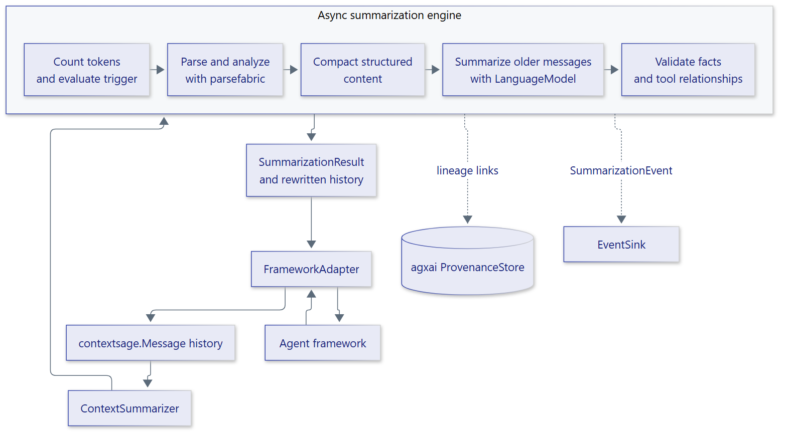

# Architecture

ContextSage is an asynchronous, framework-neutral summarization engine. It
coordinates parsefabric for content analysis and agxai for summary lineage,
while applications provide a summary model and translate their own messages
through a `FrameworkAdapter`.

<figure class="diagram" markdown="span">
  { width="720" }
  <figcaption>The framework-neutral engine and its integration boundaries.</figcaption>
</figure>

## Data flow

```text
Framework messages
       |
FrameworkAdapter
       |
contextsage.Message history
       |
ContextSummarizer
  | count and trigger
  | parse, analyze, preserve
  | compact structured content
  | summarize older messages
  | validate and recover
  +----> agxai provenance store
  +----> EventSink
       |
rewritten Message history
       |
FrameworkAdapter
       |
Framework messages
```

## Components

| Component | Responsibility |
| --- | --- |
| `ContextSummarizer` | Coordinates asynchronous budget checks, analysis, model calls, validation, recovery, provenance and events |
| `Message` | Neutral message with role, text, tool relationships, optional native message and summary lineage |
| `FrameworkAdapter` | Converts native messages to and from the neutral model |
| parsefabric | Parses mixed content, routes custom parsers, runs analysis away from the event loop, and supplies model/tokenizer ABCs |
| `PreservationPolicy` | Sets importance thresholds and JSON compaction level |
| `TokenCounter` | Counts the full history for the selected model |
| agxai runtime | Stores provenance and routes registered capabilities |
| `EventSink` | Receives content-free `SummarizationEvent` records |

## Design properties

- **Async-first:** engine, model, persistence and event-delivery operations are
  awaited. CPU-bound parsing uses an execution backend.
- **Framework-neutral:** the core wheel has no LangChain or LangGraph
  dependency. Optional integrations adapt native types at the boundary.
- **Deterministic analysis:** parsing, scoring, compaction and validation are
  deterministic for the same history and configuration; only summary text is
  generated.
- **Bounded preservation:** structural facts and tool relationships are
  checked before the rewritten history is returned.
- **Content-free events:** summary telemetry reports counts and statuses,
  not message content or credentials.
- **Explicit extension points:** project and dependency customization uses
  abstract base classes and validated configuration objects.

See [how it works](guide/how-it-works.md) and
[downstream integrations](guide/integrations.md).
