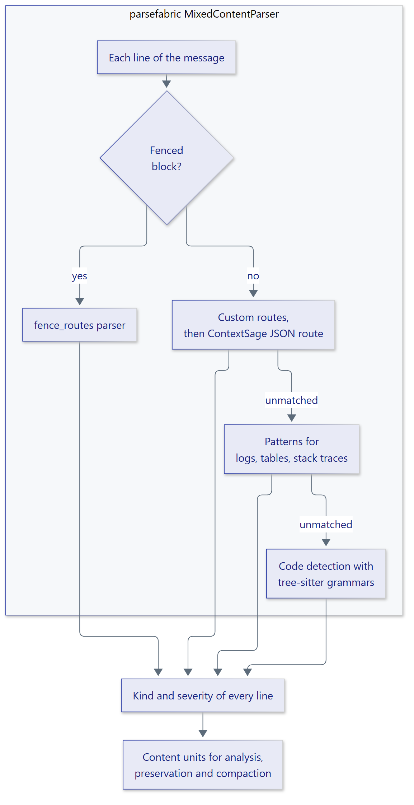

# Content parsing

ContextSage uses parsefabric's mixed-content parser to identify prose, JSON,
logs, tables, code and stack traces inside each `Message.content`. Parsing
determines which deterministic compaction and preservation rules apply.
Configure it with `ParsingOptions`:

<figure class="diagram" markdown="span">
  { width="720" }
  <figcaption>Custom routes are applied before the default JSON route.</figcaption>
</figure>

```python
from contextsage import ContextSummarizer, ParsingOptions


async def prepare_summarizer(model):
    async with ContextSummarizer(
        model,
        parsing=ParsingOptions(max_concurrency=16),
    ) as summarizer:
        await summarizer.prepare()
```

## Extension points

| Option | Purpose |
| --- | --- |
| `patterns` | Replace the default log, traceback and table line patterns. Start with `default_patterns()` to extend them. |
| `routes` | Route lines selected by a parsefabric `Pattern` to a parser or registered parser name. |
| `fence_routes` | Select a parser for fenced code blocks by language tag. |
| `code_detector` | Recognize unfenced code; defaults to parsefabric's tree-sitter detector. Set to `None` to disable. |
| `json_codec` | Supply a parsefabric JSON codec. |
| `registry` | Resolve parser names used in `routes` and `fence_routes`. |
| `sink` | Receive parsefabric lifecycle events. ContextSage summary events use `ContextSummarizer.sink`. |
| `backend` | Supply an execution backend for CPU-bound parsing and analysis. You own its shutdown. |
| `max_concurrency` | Bound concurrent message parsing; defaults to 8. |

Use the parsefabric ABCs for patterns, parsers, codecs, sinks and backends.
Routes are applied before ContextSage's JSON route, allowing a custom parser
to handle matching content first.

## Code grammars

The default code detector prepares grammar resources lazily. Call
`await summarizer.prepare()` during startup to validate them before serving
requests. When code recognition is not needed, disable the detector instead
of loading grammars.

## Examples

- [Custom parsing](../../examples/custom_parsing.py) routes SQL to a custom
  parser.
- [Downstream customization](../../examples/downstream_customization.py)
  supplies a custom JSON codec, lifecycle sink and execution backend.
