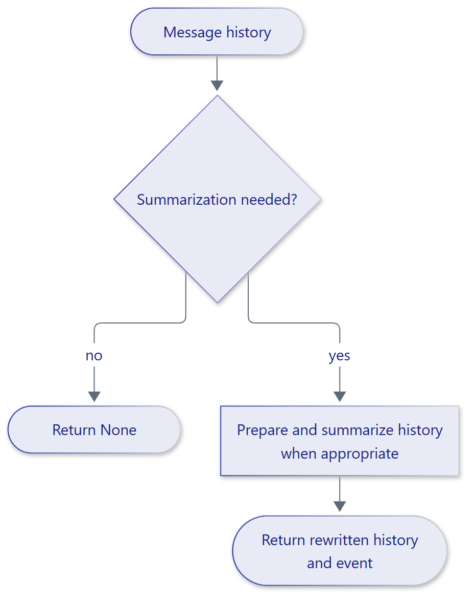

# How it works

`ContextSummarizer.summarize` receives the full message history, oldest
first. It returns a `SummarizationResult` when it rewrites the history, or
`None` when no trigger fires and no rewrite is needed.

<figure class="diagram" markdown="span">
  { width="720" }
  <figcaption>One asynchronous summarization call.</figcaption>
</figure>

## Summarization

The configured trigger and context budget determine whether a rewrite is
needed. ContextSage processes mixed content according to the preservation
policy and uses the configured model for older messages when appropriate.
Leading system messages and the configured recent window are retained.
Validation and recovery outcomes are reported in the event; summary lineage
is stored through agxai.

## Async execution

All engine operations are asynchronous. Parsing and analysis run through a
parsefabric `ExecutionBackend`, which defaults to a worker thread so CPU-bound
work does not block the event loop. A caller-supplied backend remains owned by
the caller and must be shut down by that owner. Summary-model and persistence
calls are awaited directly.

## Results and failures

The `SummarizationResult` contains the complete replacement history and its
event. Use the returned messages as the next history; they include unchanged
messages as well as any summary and recovery content.

Summary-model exceptions normally trigger the bounded trimming fallback.
Supply exception classes in `propagate_errors` when the framework uses them
for control flow. Cancellation is propagated. Parsing failures are logged and
the engine continues with an unanalyzed history; event-sink delivery errors
are logged without failing the agent turn.

## Provenance

Each summary has a stable ID and embeds its lineage in `Message.lineage`.
`ContextSummarizer.lineage(summary_id, thread_id=...)` queries agxai for the
links back to original messages. Store the same lineage metadata when
checkpointing or adapting messages so later generations remain connected.

See [architecture](../architecture.md), [provenance](provenance.md), and the
[API reference](../reference/index.md).
