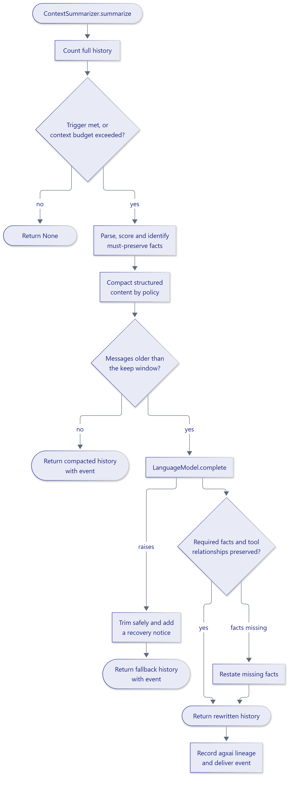

# How it works

`ContextSummarizer.summarize` receives the full message history, oldest
first. It returns a `SummarizationResult` when it rewrites the history, or
`None` when no trigger fires and no rewrite is needed.

<figure class="diagram" markdown="span">
  { width="720" }
  <figcaption>One asynchronous summarization call.</figcaption>
</figure>

## Processing stages

1. **Count and decide.** The configured `TokenCounter` counts the history.
   `trigger` or the available context budget determines whether to run.
2. **Parse and analyze.** parsefabric identifies content units such as prose,
   JSON, logs, tables, code and stack traces. ContextSage scores units,
   identifies facts to preserve, and tracks tool-call relationships.
3. **Compact.** Repetitive structured content is compacted deterministically
   according to the active `PreservationPolicy`.
4. **Summarize.** The configured `LanguageModel` summarizes messages older
   than the `keep` window. Leading system messages remain in the history.
5. **Validate and recover.** Required facts are checked in the result. Missing
   facts are restated; if the model call fails, the engine trims to the keep
   window and adds a recovery notice.
6. **Record and report.** Summary lineage is written through agxai's
   `ProvenanceStore`, and a content-free `SummarizationEvent` is delivered to
   the configured sink.

## Async execution

All engine operations are asynchronous. Parsing and analysis run through a
parsefabric `ExecutionBackend`, which defaults to a worker thread so CPU-bound
work does not block the event loop. A caller-supplied backend remains owned by
the caller and must be shut down by that owner. Summary-model and persistence
calls are awaited directly.

## Results and failures

The `SummarizationResult` contains the complete replacement history and its
event. Use the returned messages as the next history; they include unchanged
messages as well as any summary and recovery content.

Summary-model exceptions normally trigger the bounded trimming fallback.
Supply exception classes in `propagate_errors` when the framework uses them
for control flow. Cancellation is propagated. Parsing failures are logged and
the engine continues with an unanalyzed history; event-sink delivery errors
are logged without failing the agent turn.

## Provenance

Each summary has a stable ID and embeds its lineage in `Message.lineage`.
`ContextSummarizer.lineage(summary_id, thread_id=...)` queries agxai for the
links back to original messages. Store the same lineage metadata when
checkpointing or adapting messages so later generations remain connected.

See [architecture](../architecture.md), [provenance](provenance.md), and the
[API reference](../reference/index.md).
