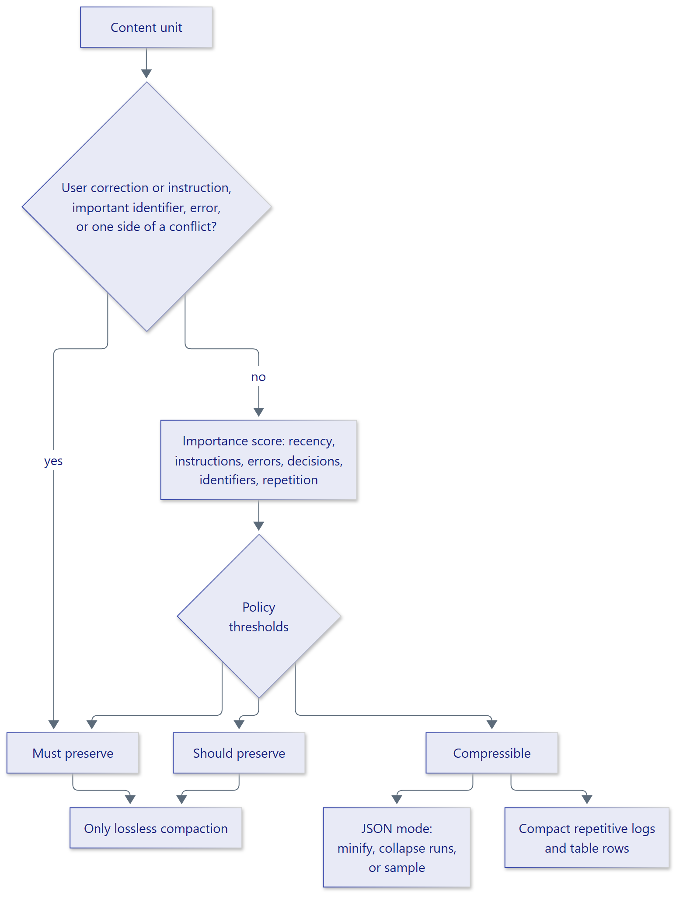

# Preservation policies

A `PreservationPolicy` determines the importance thresholds used to classify
content and how far JSON may be compacted. The policy does not override
structural protections: user corrections, identifiers associated with
failures, both sides of contradictions, and repetitive content keep their
special handling under every policy.

<figure class="diagram" markdown="span">
  { width="720" }
  <figcaption>Preservation decisions combine structural signals and policy thresholds.</figcaption>
</figure>

## Built-in policies

| Policy | Use when | JSON compaction |
| --- | --- | --- |
| `MaximumPreservationPolicy` | Retaining as much structured detail as possible matters most | Minify whitespace only |
| `BalancedPolicy` | A balance of compression and detail is appropriate; this is the default | Collapse consecutive repeated items |
| `MaximumCompressionPolicy` | Smaller context is more important than retaining long low-value lists | Collapse repeated items and sample long lists |

Pass an instance to `ContextSummarizer(policy=...)`.

## Custom policy

Subclass the ABC and provide thresholds and a JSON compaction mode:

```python
from contextsage import JSONCompaction, PreservationPolicy, PreservationThresholds


class AuditPolicy(PreservationPolicy):
    @property
    def thresholds(self) -> PreservationThresholds:
        return PreservationThresholds(must=0.55, should=0.25, error_must=0.40)

    @property
    def json_compaction(self) -> JSONCompaction:
        return JSONCompaction.MINIFY
```

Threshold values must be between zero and one, and `should` cannot exceed
`must`. `error_must` is the lower threshold used for content reporting errors.
See the [policy example](../../examples/policies.py).
