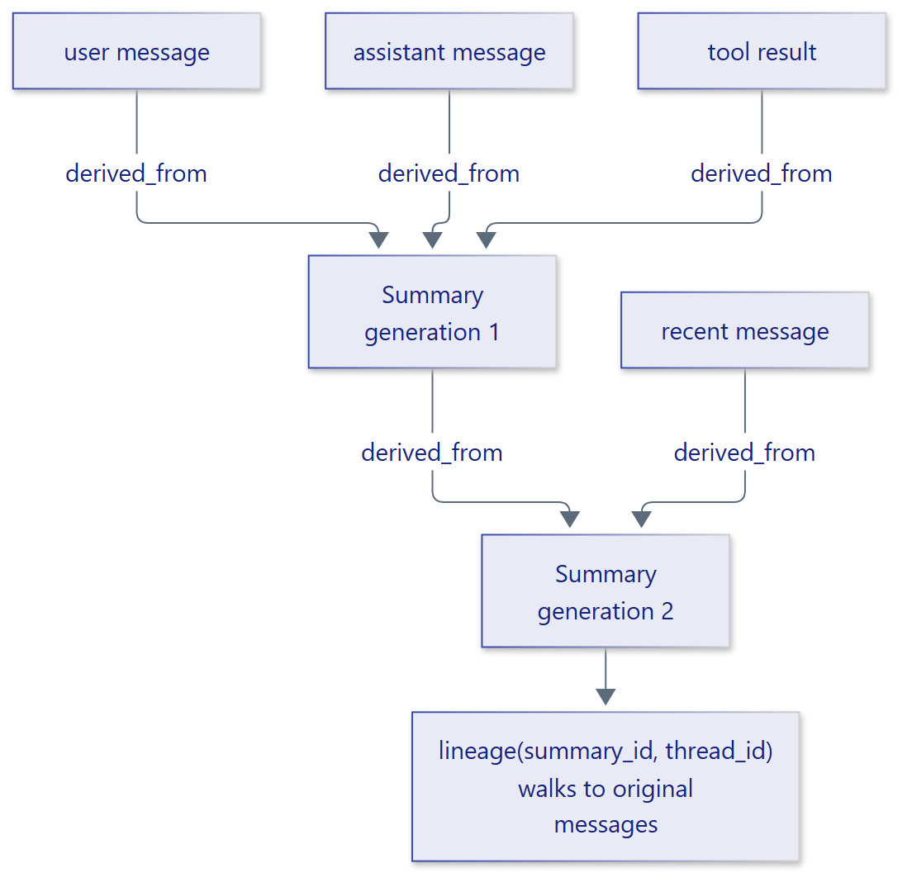

# Provenance and lineage

Each summary has an ID, a generation number, source-summary IDs and the facts
that later summaries must retain. `Message.lineage` carries this information
with the message, so it remains available when agent state is checkpointed.

<figure class="diagram" markdown="span">
  { width="720" }
  <figcaption>Lineage survives successive summary generations.</figcaption>
</figure>

The engine writes agxai `ProvenanceLink` records from each replaced message
to the summary that represents it. Use a thread ID consistently when
summarizing and querying:

```python
async def summarize_and_trace(summarizer, messages):
    result = await summarizer.summarize(messages, thread_id="thread-42")
    if result is not None and result.event.summary_id is not None:
        links = await summarizer.lineage(
            result.event.summary_id,
            thread_id="thread-42",
        )
```

`delete_lineage(thread_id=...)` removes that thread's provenance links from
the configured store. The summary messages remain unchanged.

## Configure agxai storage and providers

The default runtime uses agxai's in-memory provenance store. For persistence,
provide an agxai `ProvenanceStore` when creating a runtime:

```python
async def summarize_with_store(model, my_store, messages):
    runtime = create_agxai_runtime(store=my_store)
    async with ContextSummarizer(model, runtime=runtime) as summarizer:
        return await summarizer.summarize(messages)
```

`create_agxai_runtime` also accepts agxai configuration, a registry,
application/tenant/graph identity, plugins, custom state capture, and custom
observability, attribution, explanation, policy and capture-policy providers.
This keeps lineage interoperable with other agxai instrumentation in the
agent. See [downstream customization](integrations.md#downstream-customization)
and the [PostgreSQL example](../../examples/postgres_store.py).
