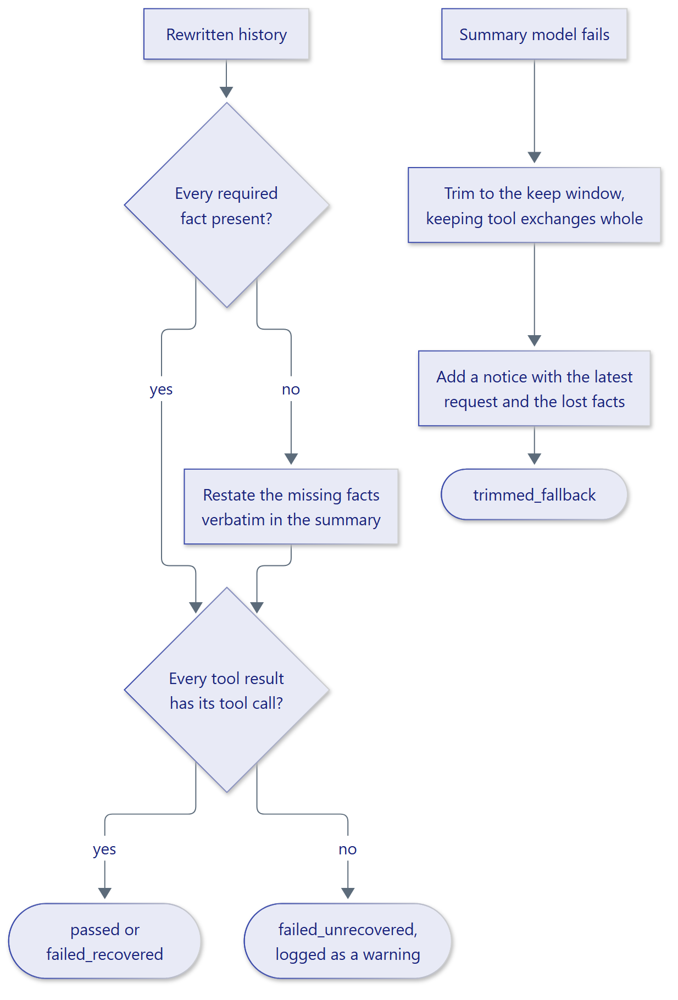

# Validation and recovery

After the summary model returns, ContextSage checks that facts selected for
preservation still appear in the rewritten history and that tool results
remain paired with their calls.

<figure class="diagram" markdown="span">
  { width="720" }
  <figcaption>Validation and recovery outcomes are reported in the event.</figcaption>
</figure>

## Fact validation

Facts include user corrections and instructions, identifiers in important
content, and both sides of detected contradictions. Matching is performed
against the output messages. If a fact is missing, ContextSage appends its
statement to the summary and reports `failed_recovered` with
`restated_facts`. The lineage travels with the summary so later generations
retain the same requirements.

Set `validation_enabled=False` only when your application has another
validation step or has measured that the check is unnecessary. The
`SummarizationEvent` reports `disabled` in that case.

## Summary-model failure

Exceptions from `LanguageModel.complete` trigger a bounded fallback: the
engine keeps the configured recent window, avoids starting at an orphaned
tool result, and adds a notice with the latest user request and required facts
that were outside the window. The event reports `trimmed_fallback`.

If a framework exception signals control flow rather than a model failure,
pass its type in `propagate_errors`. Cancellation always propagates.

## Observe outcomes

`SummarizationEvent.validation_status` can be `passed`,
`failed_recovered`, `failed_unrecovered`, `skipped`, or `disabled`.
`recovery_status` describes whether facts were restored or trimming was
used. An unmatched tool result is logged because adding facts cannot repair
its missing tool call.

See the [recovery example](../../examples/recovery.py) and the
[event reference](../reference/index.md#configuration-and-events).
